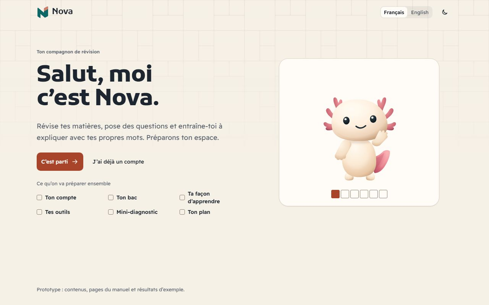
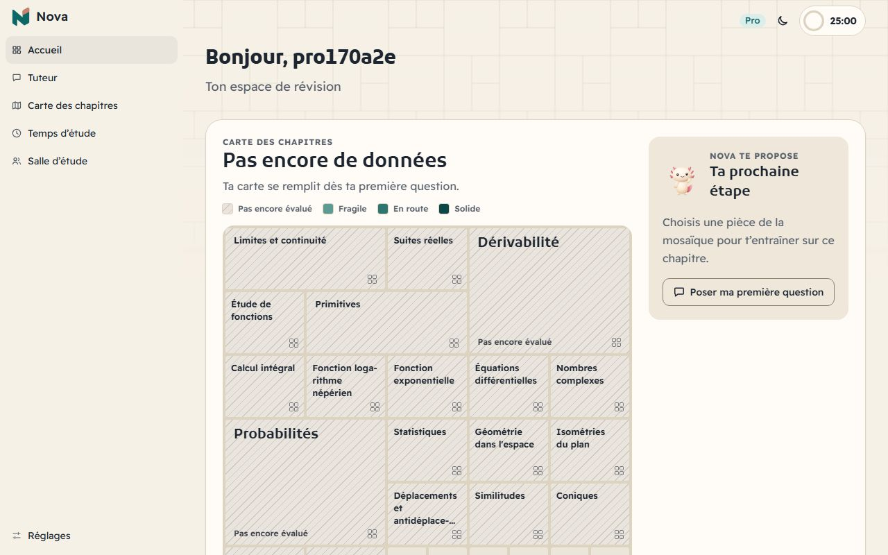
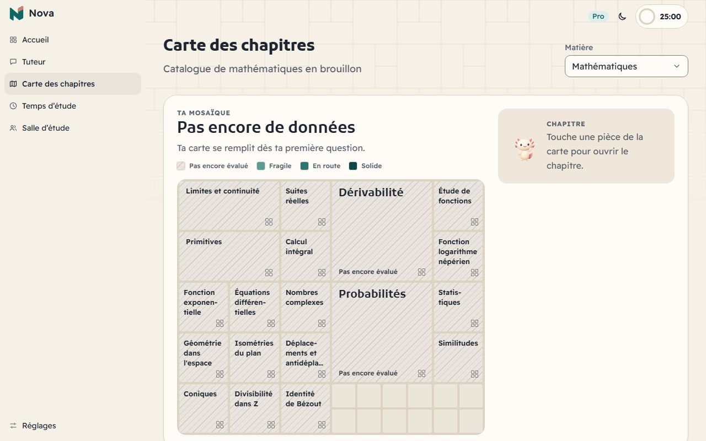
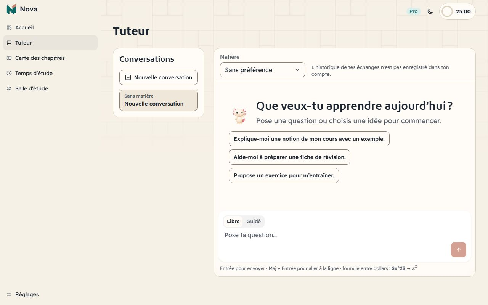
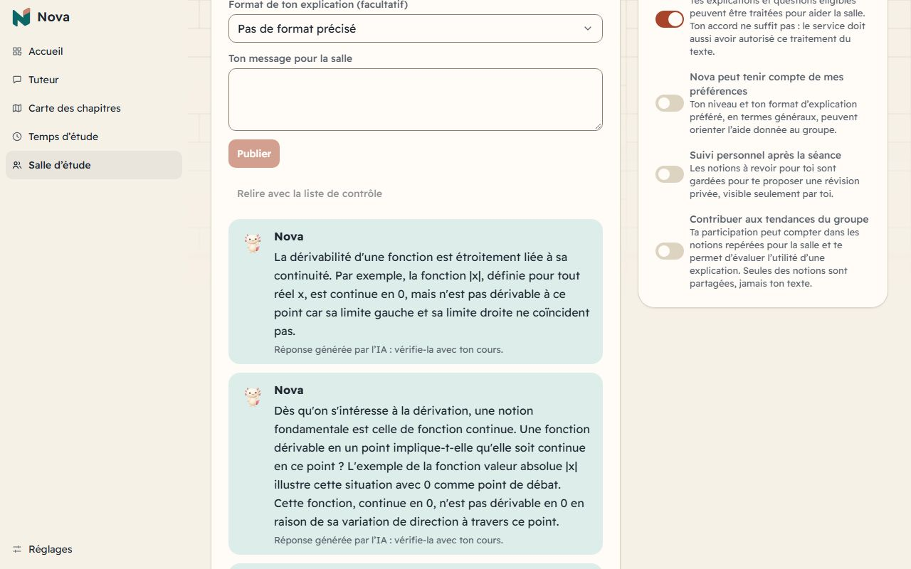
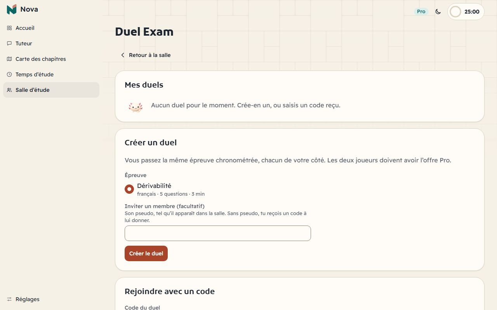
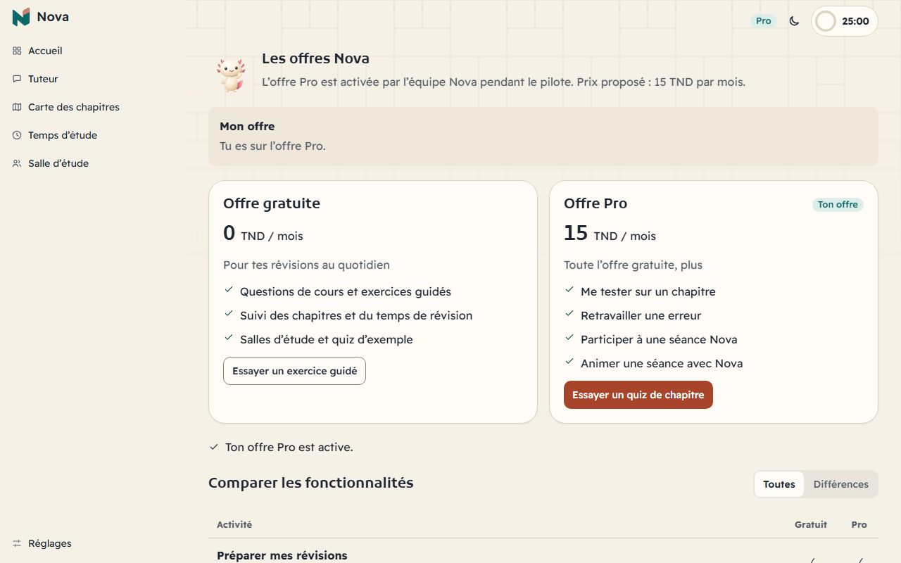
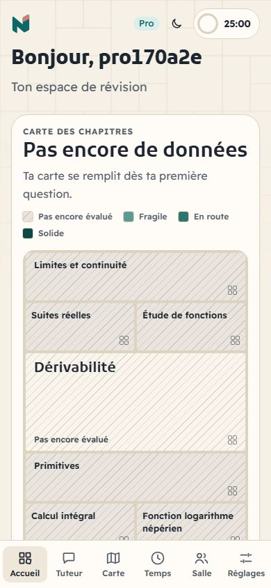

# Nova

Nova is a study companion for Tunisian baccalaureate students, built for IEEE WIE ACT 5.0. Nova is also the axolotl mascot and the AI tutor in the app. A short diagnostic helps learners choose how to study. Nova can explain course material with citations, offer hints one at a time, and help learners check their own explanations in a study room.

## UI screenshots

These screens use fictional data, in the light "Jour" theme.

| Welcome | Accueil | Chapter map |
| --- | --- | --- |
|  |  |  |

| Tutor | Study room | Duel lobby |
| --- | --- | --- |
|  |  |  |

| Plans | Phone |
| --- | --- |
|  |  |

## Try Nova locally

Run the web app from the repository root with `npm --prefix web install && npm --prefix web run dev`, then open http://127.0.0.1:4175. The dev server proxies the backend, so start the backend first (step 3 below).

### Docker Compose

For the complete connected stack:

```bash
cp .env.example .env
# Set a strong SECRET_KEY and the challenge-provided LLM_API_KEY in .env.
docker compose up --build
```

Open http://127.0.0.1:4175. PostgreSQL, Redis, RAG, the agent, the backend, and the web app each run in
their own container. The `web` container serves the production build of `web/` and proxies `/api` to the
backend service (`EDNOVA_BACKEND_HOST=backend`, `EDNOVA_BACKEND_PORT=9999`). PostgreSQL, the RAG index, Redis and
agent state use named volumes. Stop the stack with `docker compose down`; add `-v` only when you also want to
delete stored demo data.

The app requires Node.js, Python 3.12, PostgreSQL 16, and an authorized key during an active challenge access window.

| Start order | Service | Local port |
| --- | --- | --- |
| 1 | [Course retrieval and verified-source index](RAG/README.md#official-platform-demo) | 8001 |
| 2 | [Agent and official inference platform configuration](llm_service/README.md#run-with-the-official-platform) | 8100 |
| 3 | [PostgreSQL and backend API](Backend/README.md#run) with `AGENT_URL=http://127.0.0.1:8100` | 9999 |
| 4 | [Web app](web/) (`npm --prefix web run dev`) | 4175 |

Open the [web app](http://127.0.0.1:4175), register with a fictional username, and select **Experimental Sciences** in Settings to try verified math and physics citations. Ask Nova for a guided exercise on differentiability. Keep the team key in the ignored `llm_service/.env` file and use the official platform during your assigned slot.

## How it works

The browser talks to the backend through the web app's dev server. The backend handles accounts, profiles, study rooms, and sessions, then calls the internal agent. The agent retrieves course passages from a hybrid search index and uses the official platform for generation. The compact model handles routing and short tasks, while the larger model handles tasks such as building hint ladders. The agent limits outbound attempts to 20 per rolling minute and two in flight per worker. When generation takes too long, it can show a cited course excerpt and a retry time.

Study rooms use 6-character invite codes. The owner starts a session on a chapter: Nova sets a goal and runs explain, question and quiz rounds. Members share explanations or ask anonymous questions. A member who stays silent for five minutes gets a direct question from Nova. At the end, Nova writes shared notes and each member sees their own points to review. On their own, learners get the missing points of an explanation, mistakes labelled by type for later practice, and chapter quizzes generated once by the larger model and reused from the cache.

The live demo index uses ten team-authored documents with verified usage permissions. The backend stores chat metadata, and conversation text stays in memory for the active visit. The inference key stays on the agent side.

The interface is available in French, English and Arabic (right to left). Arabic interface text awaits native-speaker review.

## Business model

Students use Nova for free. Training centres and tutors are the paying customers, with a Pro tier for students, a class plan for centres, and institution licences. Adoption starts with student clubs, moves to centre pilots in months 4–12, and to institution licences in year 2. Estimated AI cost is about 0.10 TND per student per month. Figures are estimates to be validated in pilots.

## Offline validation

The agent and frontend test suites run without an inference key. The backend suite uses a disposable PostgreSQL database and mocks the agent.

- Frontend: run `npm --prefix web test` and `npm --prefix web run build` from the repository root.
- Browser tests: see [e2e/README.md](e2e/README.md).
- Agent: run `pytest -q` from `llm_service/` after installing its development dependencies.
- Backend: follow the [database and test instructions](Backend/README.md#tests).

GitHub Actions runs the web app, agent, RAG, backend, and Docker Compose builds on every push and pull request.

## Latest improvements

### Reproducible deployment

- Added Dockerfiles for the web app (`web/`), backend, LLM agent, and RAG service.
- Added a complete `compose.yaml` stack with PostgreSQL, Redis, RAG, agent, backend, and web containers.
- Added named volumes for PostgreSQL, RAG indexes, Redis state, and agent state.
- Added `.env.example` and container health checks for local startup and review.

### Continuous integration

- Added a GitHub Actions workflow covering the web app (typecheck, unit tests, build), LLM tests and lint, RAG tests, backend tests
  with PostgreSQL, Docker Compose validation, and service image builds.

### Persistent and shared state

- Added Redis-backed agent caches and shared conversation state for multi-worker deployments.
- Added PostgreSQL persistence for quiz answer keys, with ownership and two-hour expiry.
- Kept RAG indexes in persistent named volumes and exposed Redis as shared storage in Compose.

### RAG corpus expansion

- Expanded the local corpus to 53 documents and more than 2,000 chunks.
- Added original EdNova material covering primitives, integrals, logarithms, exponentials, differential
  equations, sequences, Newton's laws, electrical power and energy, and immunity.
- Added 15 new evaluation questions and additional French/Arabic/English glossary concepts.
- The test split reached 80.4% recall@5 in local Embedding retrieval evaluation.

### Production source controls

- Added `RAG/data/approved_sources.csv` as the explicit source-review register.
- RAG production ingestion now requires both manifest permission approval and `approved=yes` review
  metadata; OCR drafts and unreviewed documents remain excluded until human sign-off.
- Existing source and review data is preserved with clear `REVIEW` markers and an unverified status.

## Verification

- Web app: 305 tests passed, `tsc -b` and `npm run build` clean.
- LLM agent: 375 passed and 1 skipped (the skip needs a built RAG index).
- RAG: 33 tests passed.
- Docker Compose configuration and Python modules pass local validation.

### Chapter mind maps

In **Carte des chapitres**, choose maths, physics, or SVT and select a chapter under **Cartes mentales**. The pilot covers six chapters for Sciences expérimentales learners, including **Immunité** in SVT. Pro learners can generate maps and return to their saved maps after signing in again. **Demander à Nova** opens a new conversation about the selected concept.

After updating a pilot source, rebuild and restart the verified RAG index and verify its chapter excerpts before advancing the chapter's source revision in the backend registry.
