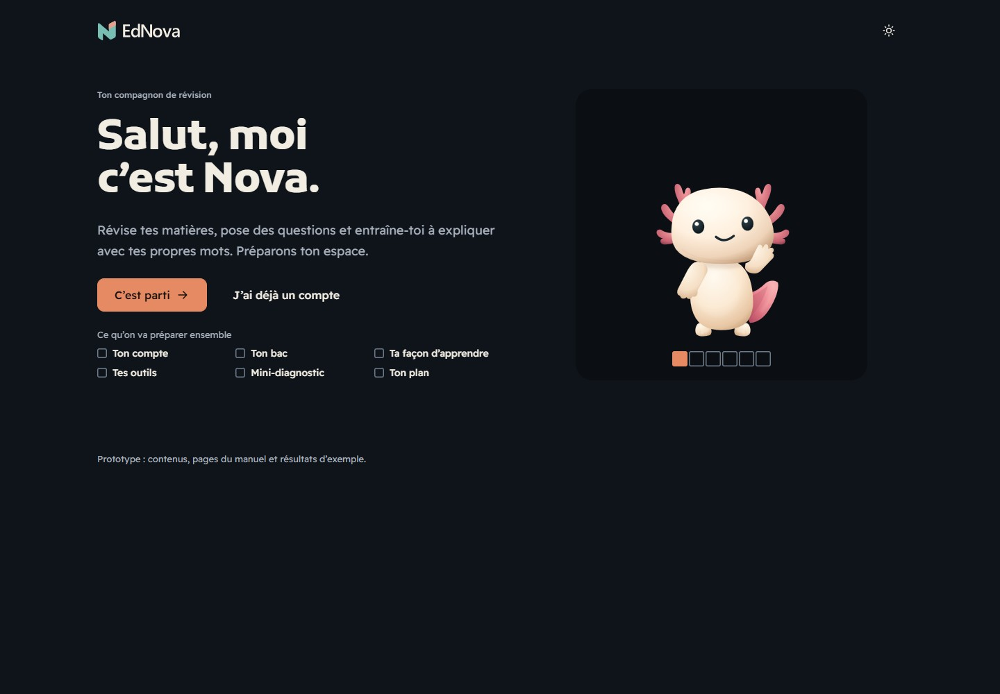
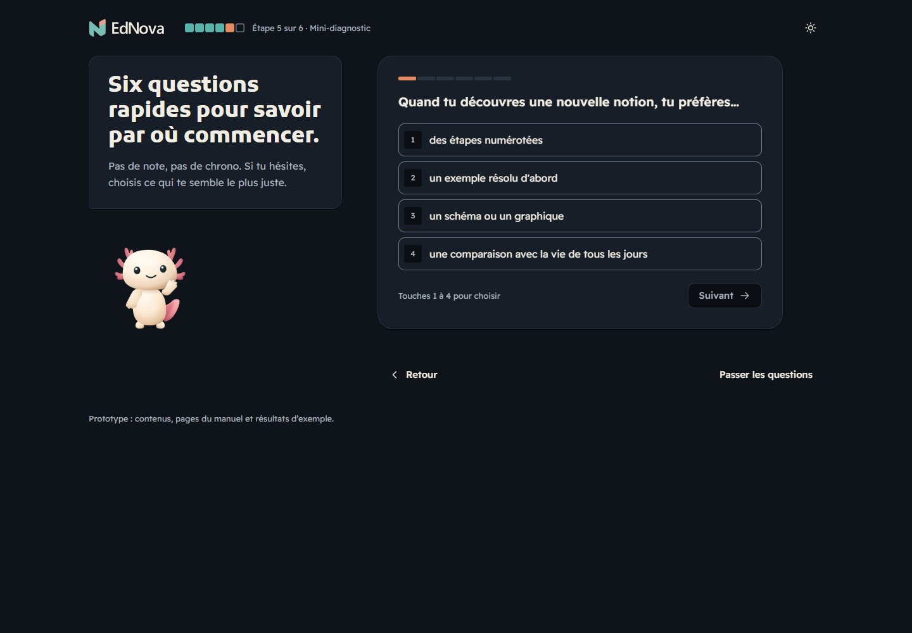
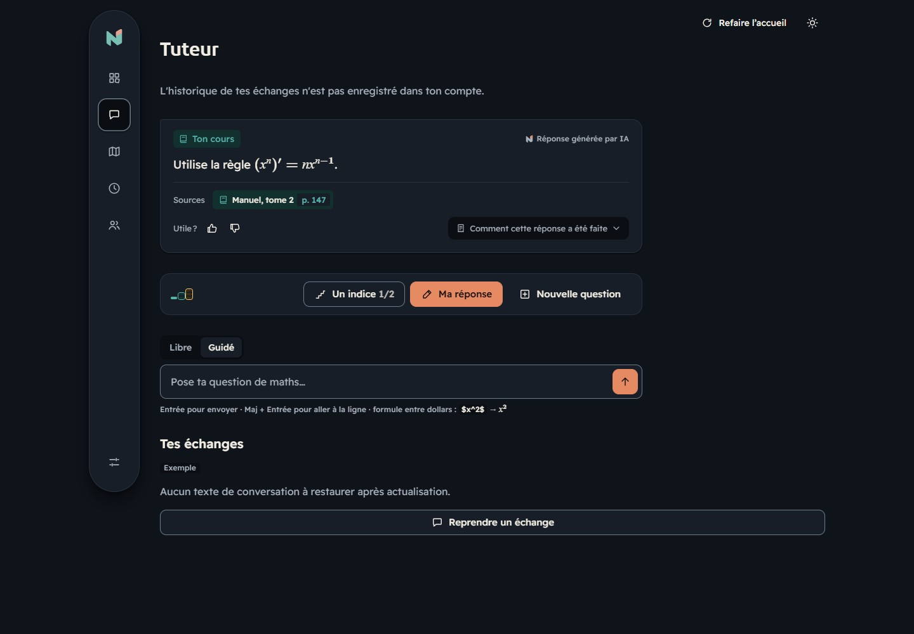

# EdNova

EdNova is a study companion for Tunisian baccalaureate students, built for IEEE WIE ACT 5.0. A short diagnostic helps learners choose how to study. Nova can explain course material with citations, offer hints one at a time, and help learners check their own explanations in a study room.

## UI screenshots

These screens use fictional data from the offline preview.

| Welcome | Study diagnostic | Guided tutor |
| --- | --- | --- |
|  |  |  |

## Try EdNova locally

For a quick walkthrough, run `node ui-preview/scripts/serve.mjs` from the repository root, then open the [offline review gallery](http://127.0.0.1:4173/review.html). This mode uses fixtures and needs no API key or database.

The connected app requires Node.js, Python 3.12, PostgreSQL 16, and an authorized key during an active challenge access window. Use the offline gallery to review the interface when the official API is closed.

| Start order | Service | Local port |
| --- | --- | --- |
| 1 | [Course retrieval and verified-source index](RAG/README.md#official-platform-demo) | 8001 |
| 2 | [Agent and official inference platform configuration](llm_service/README.md#run-with-the-official-platform) | 8100 |
| 3 | [PostgreSQL and backend API](Backend/README.md#run) with `AGENT_URL=http://127.0.0.1:8100` | 9999 |
| 4 | [Connected preview](ui-preview/README.md#connected-demo) | 4173 |

Open the [connected app](http://127.0.0.1:4173/live.html), register with a fictional username, and select **Experimental Sciences** in Settings to try verified math and physics citations. Ask Nova for a guided exercise on differentiability. Keep the team key in the ignored `llm_service/.env` file and use the official platform during your assigned slot.

## How it works

The browser talks to the backend through the local preview server. The backend handles accounts, profiles, study rooms, and sessions, then calls the internal agent. The agent retrieves course passages from a hybrid search index and uses the official platform for generation. The compact model handles routing and short tasks, while the larger model handles tasks such as building hint ladders. The agent limits outbound attempts to 20 per rolling minute and two in flight per worker. When generation takes too long, it can show a cited course excerpt and a retry time.

The live demo index uses ten team-authored documents with verified usage permissions. The backend stores chat metadata, and conversation text stays in memory for the active visit. The inference key stays on the agent side.

## Offline validation

The agent and frontend test suites run without an inference key. The backend suite uses a disposable PostgreSQL database and mocks the agent.

- Frontend: run `node --test ui-preview/tests/*.test.mjs` from the repository root.
- Agent: run `pytest -q` from `llm_service/` after installing its development dependencies.
- Backend: follow the [database and test instructions](Backend/README.md#tests).
